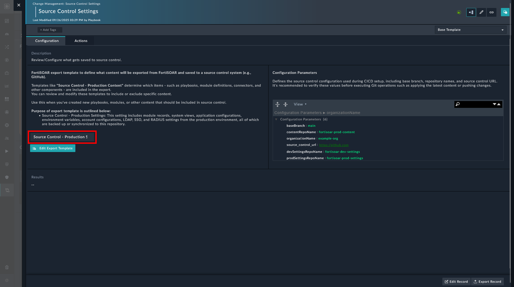
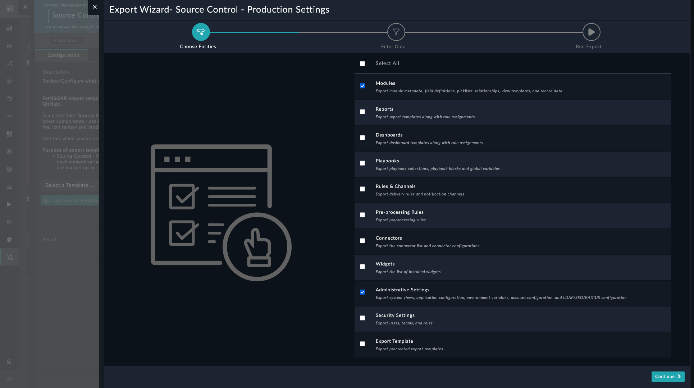
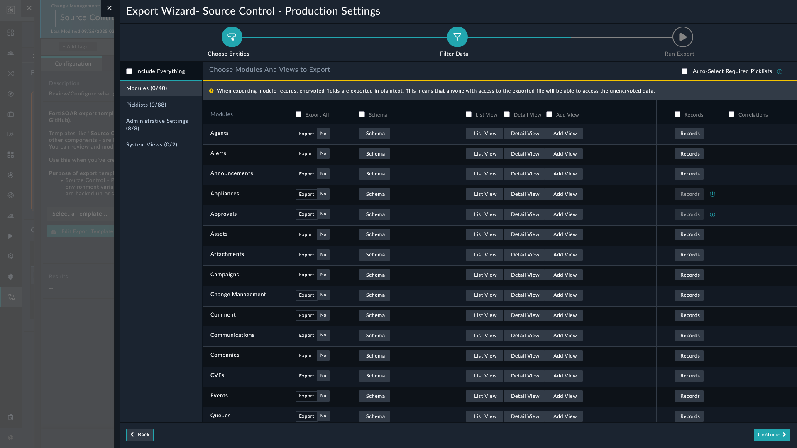
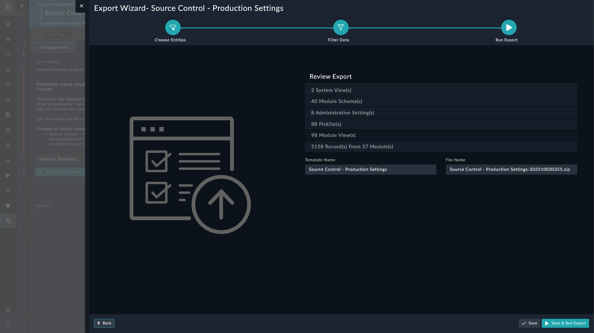

| [Home](../README.md) |
|----------------------|

# Editing the export template

Both the *Production* and *Development* environments have the option to edit what is being written to the production and development repositories.

1. Set up the Continuous Delivery on FortiSOAR environment. Refer to [setting up Continuous Delivery on FortiSOAR](./setup.md#setting-up-continuous-delivery-on-fortisoar).

2. Set up *Production* and *Development* environments. Refer to [setting up the production environment](./setup-prod-env.md) and [setting up the development environment](./setup-dev-env.md).

3. Open the *Production* or the *Development* tab under **Continuous Delivery**.

4. Click the **Source Control Settings** card.

5. Select a template to edit:

    - `Source Control (CR-<number>) - Production Content`: content for a specific change request (CR). Each CR has its own template, which is deleted when the CR is closed.
    - `Source Control - Production Settings`: production settings.
    - `Source Control - Development Settings`: development settings.
    - `Source Control - Production Content`: the shared content template, used for the initial production content push.

    

6. Click the button **Edit Export Template**.

    

7. Select the modules to export and click **Continue**.

    

8. Select the modules and views to export and click **Continue**.

    

9. Review the export and click **Save and Run Export**.

# Next steps

| [Installation](./setup.md#installation) | [Configuration](./setup.md#configuration) | [Usage](./usage.md) | [Contents](./contents.md) |
|----------------------------------------------|------------------------------------------------|--------------------------|--------------------------------|