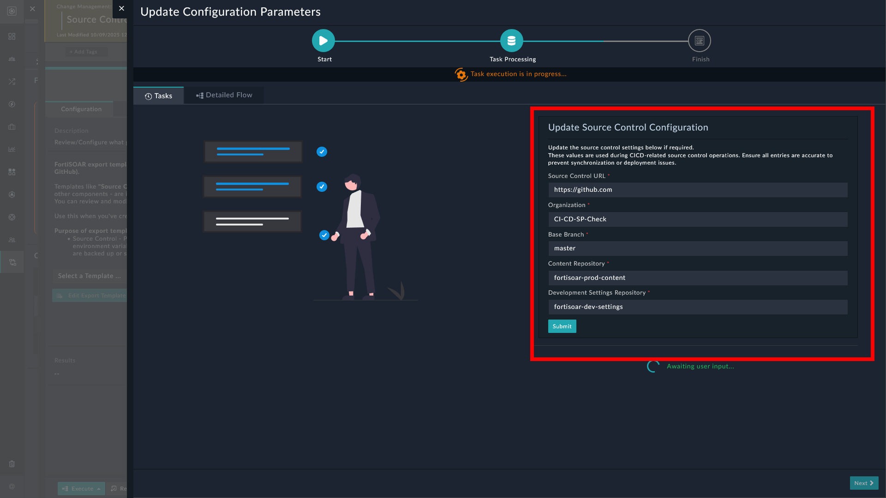

| [Home](../README.md) |
|----------------------|

## Setting up the development environment

Once you have set up source control for the production environment, set up the development environment to bring dev content changes under the purview of source control.

---
### Prerequisites

Confirm the following before you set up the development environment.

1. Source Control must already be set up for the production environment. See [Setting up the production environment](./setup-prod-env.md).

2. A source control connector already configured, for tracking and managing changes to code:

    - To configure and use the GitHub connector to track and manage changes through GitHub, refer to [Configuring GitHub](https://docs.fortinet.com/fortisoar/connectors/github).

    - To configure and use the GitLab connector to track and manage changes through GitLab, refer to [Configuring GitLab](https://docs.fortinet.com/fortisoar/connectors/gitlab).

---

To set up the development environment:

1. Select **Continuous Delivery** from the FortiSOAR menu.

2. Click the button **Setup Source Control** under the **Setup** tab.

3. Click the button **Setup Dev Environment** from the lower left part of the screen.

4. Enter the source control username to map with the logged in user in FortiSOAR.

5. Enter the Source Control details:

    

    1. Enter the Organization's name as created on your preferred source control platform.

    2. Enter the repository names to be created under the specified organization. To accept the auto-populated suggested name, leave the fields as-is.

    3. Enter the **Base Branch Name** to be created under the specified repositories. To accept the auto-populated suggested name, leave the field as-is.

    4. Click **Setup** to proceed.

    5. Click the button **Create Repositories** to let the playbooks automatically create the repo (repository) and the specified branch in each repo.

        1. Click the button **I have the repositories** if you have already created the repositories, with the exact same names as specified in the earlier step, on your preferred source control platform.

        2. Click the button **Confirm**, after creating the repositories, for FortiSOAR to check if the specified repositories exist.

    6. Click the button **Push** to push the content from FortiSOAR to the specified branch of the repository mentioned in Development Content.

        Pushing overwrites the contents of the repository mentioned in Development Content. You can click the button **Skip** to push the contents later.

> [!TIP]
> Once the *Development* environment is set up, click the card **Apply Latest Content** to make the development instance a clone of the *Production* instance (required if the production and development FortiSOAR instances are separate).

# Next steps

| [Installation](./setup.md#installation) | [Configuration](./setup.md#configuration) | [Usage](./usage.md) | [Contents](./contents.md) |
|----------------------------------------------|------------------------------------------------|--------------------------|--------------------------------|
